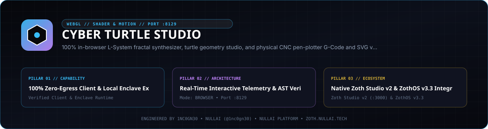

<p align="center">
  
</p>

# Cyber Turtle Studio

Pure-Python Logo DSL interpreter, Lindenmayer System (L-System) fractal grammar synthesizer, Truchet/maze generator, 2-Opt TSP pen-plotter toolpath optimizer, multi-format exporter (SVG, CNC G-Code, Unicode Braille/ASCII), and JSON-RPC 2.0 MCP server.

- **Version**: `2.5.0`
- **Local Workstation Port**: `127.0.0.1:8129`
- **Zoth Studio Dossier**: [https://zoth.nullai.tech/tools/cyber-turtle-studio](https://zoth.nullai.tech/tools/cyber-turtle-studio)
- **Author**: [1nc0gn30](https://1nc0gn30.si) (`@1nc0gn30`) · [NullAI](https://nullai.tech)

## Overview

`cyber-turtle-studio` executes algorithmic vector geometry using only the Python 3 standard library. It compiles recursive Logo procedures (`to ... end`, `repeat`, `push`/`pop`, `circle`, polygon fills), formal L-System rewriting rules (Koch, Dragon, Hilbert, Gosper, Barnsley Fern, stochastic branching), spirographs/harmonographs, Truchet tilings (`arcs`, `diagonal`, `concentric_arcs`, `cross_line`), and solvable labyrinths (`recursive_backtracker`, `wilson`, `braided`) into normalized `DrawingAST` intermediate representations.

Core capabilities:
- **Multi-Format Vector & CAM Exporters**: Themeable static or CSS stroke-animated SVGs, GRBL/Marlin CNC G-Code (`G0`/`G1` Z-axis pen lift or `M3`/`M5` laser mode), and 2x4 sub-pixel Unicode Braille (`U+2800..U+28FF`) terminal canvases.
- **2-Opt TSP Toolpath Optimizer**: Merges contiguous polylines, evaluates bidirectional reversals, and minimizes rapid pen-up air-travel distance for AxiDraw and CNC plotters.
- **Preset Registry**: 25+ categorized mathematical and botanical presets filterable by category, difficulty, and tags.
- **Dual Runtime**: Local browser workstation (`127.0.0.1:8129`) and stdio MCP server exposing 9 tools, 2 workflow prompts, and grammar resources.

## Architecture

```text
cyber-turtle-studio/
├── bin/cyber-turtle.js                    # Unified Node/ZothOS CLI & desktop launcher
├── src/cyber_turtle_studio/
│   ├── turtle_engine.py                   # Logo lexer, recursive procedure parser & TurtleEngine
│   ├── lsystem_engine.py                  # Parametric/stochastic L-System expander & interpreter
│   ├── spirograph.py                      # Hypotrochoid, epitrochoid & harmonograph curves
│   ├── truchet_maze.py                    # Truchet tile generator & BFS-solvable labyrinths
│   ├── toolpath_optimizer.py              # Nearest-neighbor + 2-Opt TSP air-travel optimizer
│   ├── exporters/                         # SVGExporter, GCodeExporter & Braille ASCIIExporter
│   ├── catalog.py                         # PresetRegistry & 25+ algorithmic presets
│   ├── ui_server.py                       # ThreadingHTTPServer REST API (:8129)
│   ├── mcp_server.py                      # MCP 2024-11-05 stdio server (9 tools, 2 prompts)
│   └── cli.py                             # 14-subcommand CLI entry point
├── public/                                # Interactive browser geometry & G-Code studio
└── tests/                                 # Pytest unit, CORS origin guard & HTTP/MCP tests
```

## Quickstart

Clone the repository, install in editable mode, and start the local workstation on `127.0.0.1:8129`:

```bash
git clone https://github.com/1nc0gn30/cyber-turtle-studio.git
cd cyber-turtle-studio
python3 -m pip install -e .

# Start the Web Studio & REST API on 127.0.0.1:8129
cyber-turtle-studio serve --host 127.0.0.1 --port 8129
```

Verify the server health endpoint:

```bash
curl -s http://127.0.0.1:8129/health
```

## CLI & MCP Usage

### CLI Subcommands

Installed scripts `cyber-turtle` and `cyber-turtle-studio` (and ZothOS v3.4.0 `/usr/local/bin/cyber-turtle`) expose:

```bash
# Help & JSON service status
cyber-turtle-studio --help
cyber-turtle-studio --status --json

# Execute Logo DSL code to SVG, G-Code, or Braille ASCII
cyber-turtle-studio logo "repeat 36 [ repeat 4 [ fd 90 rt 90 ] rt 10 ]" -o mandala.svg --animate
cyber-turtle-studio ascii dragon_curve --mode braille --width 64 --height 28

# Synthesize L-System fractals or catalog presets
cyber-turtle-studio lsystem FX -r "X=X+YF+,Y=-FX-Y" -i 10 -a 90 -o dragon.svg
cyber-turtle-studio generate koch_snowflake -f svg -o koch.svg
cyber-turtle-studio presets --json

# Export pen-plotter / laser G-Code and run 2-Opt TSP optimization
cyber-turtle-studio gcode hilbert_curve --feed 1500 --z-up 4.0 -o hilbert.gcode
cyber-turtle-studio optimize --preset dragon_curve --json

# Generate Truchet tilings and BFS-solved labyrinths
cyber-turtle-studio truchet --rows 12 --cols 12 --style concentric_arcs -o truchet.svg
cyber-turtle-studio maze --rows 20 --cols 20 --algo wilson --solve --ascii

# Diagnostics & internal self-check
cyber-turtle-studio diagnostics --json
cyber-turtle-studio test
```

### REST API Endpoints (`127.0.0.1:8129`)

| Method | Endpoint | Description |
| :--- | :--- | :--- |
| `GET` | `/health`, `/api/health`, `/api/stats` | Health status, version (`2.5.0`), catalog summary, and platform metadata |
| `GET` | `/api/presets`, `/api/catalog` | Filterable catalog of presets, categories, and tags |
| `POST` | `/api/execute-logo` | Parse and render Logo script to AST, SVG, and G-Code |
| `POST` | `/api/generate-lsystem` | Expand and render L-System axiom/rules |
| `POST` | `/api/generate-preset` | Render a named preset with parameter overrides |
| `POST` | `/api/export-svg` | Export SVG markup with theme and CSS stroke animation |
| `POST` | `/api/export-gcode` | Export plotter/laser G-Code with bed bounds and Z/M3 settings |
| `POST` | `/api/export-ascii` | Render Unicode Braille or ASCII raster preview |
| `POST` | `/api/optimize-toolpath` | Run 2-Opt TSP rapid-travel reduction and comparison SVG |
| `GET/POST` | `/api/truchet` | Generate Truchet tiling AST, SVG, and G-Code |
| `GET/POST` | `/api/maze` | Generate labyrinth AST, BFS solution path, SVG, G-Code, and ASCII |

### MCP Server (`stdio`)

Launch over `stdio` for MCP clients:

```bash
cyber-turtle-studio mcp
```

Registered MCP tools (9):
- `turtle_execute_logo` — Execute Logo DSL script and return AST bounds, SVG, Braille, or G-Code.
- `turtle_generate_lsystem` — Expand L-System grammar rules into fractal vector geometry.
- `turtle_export_svg` — Render vector or animated SVG to string or atomic file path.
- `turtle_export_gcode` — Compile CNC pen-plotter (`Z`) or laser (`M3`/`M5`) G-Code.
- `turtle_optimize_toolpath` — Minimize rapid travel distance via 2-Opt TSP.
- `turtle_generate_truchet` — Synthesize deterministic Truchet tile patterns.
- `turtle_generate_maze` — Generate and solve algorithmic labyrinths.
- `turtle_presets` — Query the built-in preset catalog.
- `turtle_diagnostics` — Return runtime and platform diagnostics.

Also provides MCP prompts `turtle_create_fractal` and `turtle_plotter_workflow` and resource `turtle://grammar-guide`.

## Testing & Verification

Run the test suite and CLI checks locally:

```bash
python3 -m pytest -q
PYTHONPATH=src python3 -m cyber_turtle_studio.cli --status --json
```

## Support

Cyber Turtle Studio is 100% free and open-source with zero paywalls. Optional support:
- [Buy Us a Coffee (Stripe)](https://buy.stripe.com/3cIfZg27PdKo2D64Ocfw40X)

## License

Released under the [MIT License](LICENSE). Copyright (c) 2026 1nc0gn30 · NullAI ([https://nullai.tech](https://nullai.tech)).
